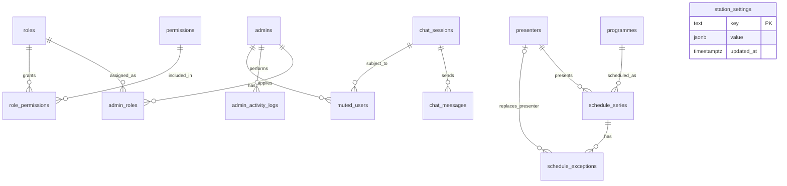

# Proposed CYI Radio architecture

The production application will run as one Express process entry point on Namecheap Stellar Plus under cPanel’s Node.js manager. Express will serve the compiled React frontend and same-origin `/api/v1` endpoints at `live.cyiradio.org`. Administrators use individual accounts with server-side RBAC and audit logging. PostgreSQL holds application records and chat history. Drizzle Kit generates reviewed SQL migrations that an operator applies explicitly.

Listeners play `https://radio.cyiradio.com/live` directly from the existing Icecast server. The backend calculates current and upcoming programmes from the effective schedule in `Africa/Accra`. Icecast status is tracked independently from the scheduled programme. The chat transport depends on the Stellar Plus account tests in the [Phase 0 report](phase-0.md).

## Proposed database ERD



`schedule_series` represents a dated one-time slot or a bounded or open-ended recurrence using local start times and selected weekdays. `schedule_exceptions` uses the series and original occurrence date as its unique key. When publishing, evaluate overlaps using effective start and end timestamps, including intervals that cross midnight. Record authorized overrides in `admin_activity_logs`.

`chat_sessions` identifies anonymous participants independently of display name. `chat_messages` references the session, and `muted_users` records each restriction and its expiration. Programme, presenter, and admin records can be archived or deactivated where historical references are needed. Add indexes for schedule lookups, message history and moderation, and model authentication session and recovery storage during the foundation and administration phases.

## Repository layout

```text
app.js                  cPanel startup entry point
frontend/               React source
server/                 Express and PostgreSQL code
migrations/             Reviewed SQL and Drizzle metadata
scripts/                Deployment and verification commands
docs/                   Compatibility evidence and operating instructions
.cpanel.yml             Manual cPanel Git deploy task
dist/                   Generated Vite output
```

Phase 1 will place the probe-only migration and related scripts outside the production migration path before introducing the first application migration. The Git checkout and Node application stay in private directories. cPanel environment variables and uploaded media are managed separately from deploy copies.

## Implementation sequence

| Phase | Deliverable and approval checkpoint |
|---|---|
| 0 | Run the hosting probe on Stellar Plus, record exact versions and limitations, and submit the compatibility findings and architecture for approval. |
| 1 | Establish the GitHub repository and production application structure, configuration, health checks and reviewed initial schema. |
| 2 | Verify player controls and Icecast availability against the existing mount. |
| 3 | Implement programmes, presenters, recurrence, exceptions, conflict detection and audited overrides. |
| 4 | Show current and upcoming programmes from the effective server-side schedule. |
| 5 | Add anonymous chat, persistence, moderation and the validated real-time transport. |
| 6 | Finish individual admin accounts, permissions, secure recovery, dashboard and audit trails. |
| 7 | Deploy through cPanel, review backup and migration steps, and verify HTTPS, restart and production behavior. |

Proceed one phase at a time after approval. At each phase, report files changed, features delivered, database changes, tests, open items and verification steps.
