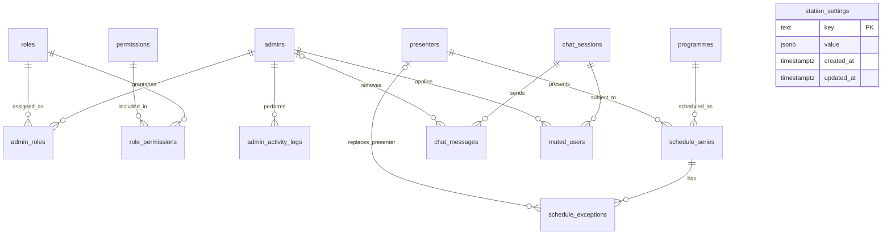

# CYI Radio architecture

The production application will run as one Express process entry point on Namecheap Stellar Plus under cPanel’s Node.js manager. Express will serve the compiled React frontend and same-origin `/api/v1` endpoints at `live.cyiradio.com`. Administrators use individual accounts with server-side RBAC and audit logging. PostgreSQL 10.23 is the compatibility target for application records and chat history. Drizzle Kit generates reviewed SQL migrations that an operator tests on that version and applies explicitly.

Listeners play `https://radio.cyiradio.com/live` directly from the existing Icecast server. The backend calculates current and upcoming programmes from the effective schedule in `Africa/Accra`. Icecast status is tracked independently from the scheduled programme. Chat uses PostgreSQL as the source of truth and HTTPS polling as the production default. Socket.IO can signal clients to refresh immediately. [Phase 5 runbook](phase-5.md)

## Database ERD



`schedule_series` represents a dated one-time slot or a bounded or open-ended weekly recurrence. It stores station-local dates and start times, a duration in minutes and a seven-bit weekday mask for weekly schedules. The low bit is Monday. `schedule_exceptions` uses the series and original occurrence date as its primary key. The scheduler validates occurrence membership and checks effective time ranges, including overnight intervals and open-ended recurrences. A transaction-level PostgreSQL lock serializes schedule writes. Authorized overrides are recorded in `admin_activity_logs`. [Phase 3 runbook](phase-3.md)

`chat_sessions` identifies anonymous participants independently of display name and stores a hash of the chat cookie token. `chat_messages` has a stable position for history and a revision for reconnects and moderation changes. `muted_users` records each restriction and its expiration. Programme, presenter and admin records support archival or deactivation to preserve historical references. Phase 6 will define the administrator authentication session and password recovery tables alongside the flows that use them.

## Repository layout

```text
app.js                  cPanel startup entry point
frontend/               React source
server/                 Express and PostgreSQL code
migrations/             Reviewed SQL and Drizzle metadata
probes/phase-0/          Archived probe migrations and external Socket.IO test
scripts/                Deployment and verification commands
docs/                   Compatibility evidence and operating instructions
.cpanel.yml             Manual cPanel Git deploy task
deploy/frontend/        Versioned frontend assets built off-host for cPanel
dist/                   Generated Vite output
```

The application migrations use a fresh database. The Phase 0 files and hosting runbook remain available for compatibility tests. The Git checkout and Node application stay in private directories. cPanel environment variables and uploaded media are managed separately from deploy copies.

## Implementation sequence

| Phase | Deliverable and approval checkpoint |
|---|---|
| 0 | Run the hosting probe on Stellar Plus, record exact versions and limitations, and submit the compatibility findings and architecture for approval. |
| 1 | Establish the GitHub repository and production application structure, configuration, health checks and reviewed initial schema. |
| 2 | Verify player controls and Icecast availability against the existing mount. |
| 3 | Implement programmes, presenters, recurrence, exceptions, conflict detection and audited overrides. |
| 4 | Show current and upcoming programmes from the effective server-side schedule. |
| 5 | Add anonymous chat, persistence, moderation and the validated real-time transport. |
| 6 | Finish individual admin accounts, permissions, secure recovery, dashboard and audit trails. |
| 7 | Deploy through cPanel, review backup and migration steps, and verify HTTPS, restart and production behavior. |

Proceed one phase at a time after approval. At each phase, report files changed, features delivered, database changes, tests, open items and verification steps.
